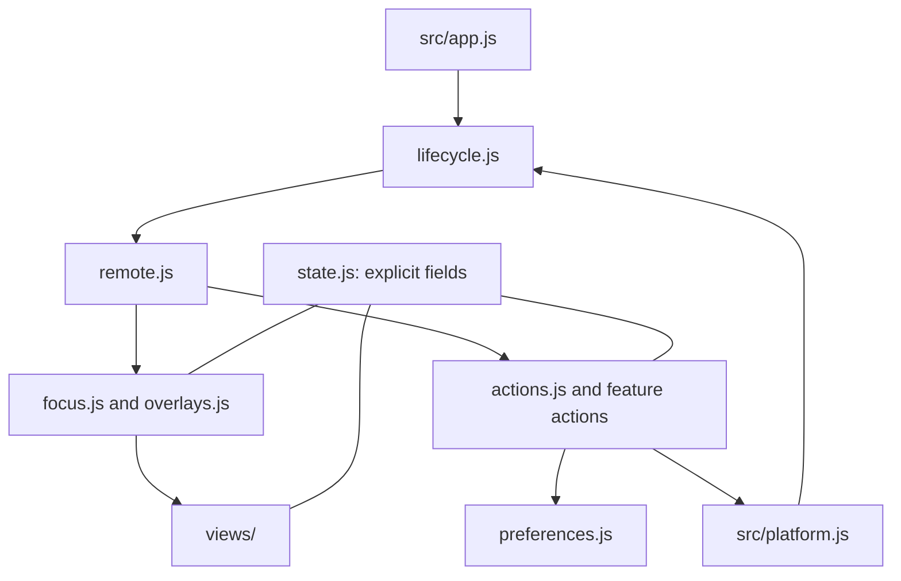

# Architecture

Start at `src/app.js`. It lists the launcher modules in startup order. `src/platform.js` is the corresponding Samsung adapter entry. These are actual ES modules: each file declares its imports and named exports, and the browser regression suite also runs the source entries directly.

## Responsibilities

| Module | Responsibility |
| --- | --- |
| `launcher/environment.js` | Browser handles, translated copy, adapter reference and root DOM node |
| `launcher/state.js` | Explicit mutable launcher state, documented by `LauncherState` in `types.d.ts` |
| `launcher/preferences.js` | Existing storage schema, profile defaults/migration and debounced writes |
| `launcher/catalogue.js`, `home-model.js` | Available apps/sources, favourites and the five home rows |
| `launcher/focus.js` | One focus owner, remembered positions and geometric scrolling |
| `launcher/remote.js` | Remote keys, hold/repeat behavior and optional frame sampling |
| `launcher/actions.js` | Launch feedback, app/input context actions and reordering entry points |
| `launcher/overlays.js` | Overlay stack, focus, navigation and Back behavior |
| `launcher/customization.js` | Profiles, shortcuts, visibility and app reordering |
| `launcher/views/` | Home/tile markup, menu/message views, text entry, inputs and control panels |
| `launcher/presentation.js` | Toasts and canvas scaling |
| `launcher/scene.js`, `weather.js`, `ambient.js` | Scene selection, weather/cache lifecycle and idle/wake behavior |
| `launcher/lifecycle.js` | Visibility handling, adapter updates, event wiring and ordered first-frame bootstrap |
| `platform/` | Native reads, writes, capability checks, diagnostics and honest unsupported fallbacks |

`views/home.js` imports `renderTileMarkup` from `views/tiles.js`; the row model and remote handler contain no tile markup. Menus and text entry are separate view modules using the same overlay controller. Native commands stay behind the adapter. Small action callbacks remain alongside the feature that owns them so their captured app/profile/source is explicit.

## Mutable state ownership

Modules import `{ state }` from `state.js`; they do not rely on free variables from another file. `frameSampling` is a separate small state object in `ambient.js`, used by the remote sampler. Read-only environment references and native `adapter` data use normal named imports.

| Fields | Owner and rule |
| --- | --- |
| `homeFocus`, `focusedElement`, `lastRenderedLevel`, `lastActiveRow` | Focus controller: exactly one visible focus, with native focus on the root except during text entry |
| `rows`, cached DOM handles and offsets | Model/view: rebuild on data changes, never on an ordinary arrow key |
| `activeOverlay`, `overlayStack` | Overlay controller: one shared Back stack and focus policy |
| `preferences`, `activeProfile`, `preferencesSaveTimer` | Preferences/customization: retain storage compatibility and the 350 ms write debounce |
| Hold, wake and navigation flags/timers | Remote/ambient controllers: long OK is distinct from a click; waking consumes the first key |
| Weather cache/request/timer and scene quality | Weather/scene modules: retain deferred work and existing cache behavior |
| Visibility and refresh timers | Lifecycle: pause background work and refresh native state on resume |

The state is explicit and typed for editor navigation, but it is still shared mutable data. This maintenance refactor does not add subscriptions, proxies, dependency injection, a reactive store or an event bus.

## Production linking

The source interfaces are real ES modules; the TV receives the same four classic JavaScript bundles and stylesheet. There are no runtime imports or per-module wrappers.

`scripts/link-modules.mjs` validates the import graph and named exports, rejects accidental free variables, then resolves imports statically. `scripts/manifest.json` retains the verified initialization order. The explicitly declared state objects are lowered into the original local variables: `state.homeFocus.row` becomes the existing `home.row` after the release-name mapping. This removes the object allocation and property-access layer from the TV build.

The linker intentionally supports a small authoring contract:

- Use relative named imports and named function/variable exports. Keep new runtime bodies compatible with ES5.
- Use explicit fields on declared state objects. Do not pass, spread, enumerate, destructure or dynamically index the whole object; its identity does not ship. The build rejects unsupported access.
- Keep bundle-level definitions uniquely named. The linker reports collisions rather than silently changing a binding. Function-local variables retain normal lexical scope.
- Put each module in the entry/dependency graph and the manifest's initialization order. Keep side effects in lifecycle/bootstrap, after dependencies have initialized.

Source comments, types, imports and exports do not ship. Descriptive function names are mapped back to their existing release names; public/native property names remain intact. Terser prints with compression and mangling disabled. Adjacent `var` declarations may be joined without moving any initialization.

`src/public/index.html` is formatted for editing. A build-only HTML minifier plus the existing JS/CSS printers reproduce its original compact bytes apart from reviewed product-name fields; the equality check protects inline boot timing, styles, attributes and markup. The early boot timestamp remains in the document to preserve where it is measured.

## Performance boundary

Navigation still uses cached geometry, existing DOM references and old/new focus updates. It adds no layout measurements, API reads, list rebuilding, dispatch wrappers or allocations. Keep native calls and network work outside that path.

Executable-tree checks allow only hoisted function declaration placement, adjacent `var` grouping, equivalent property-key quotation and spelling metadata to differ. They preserve initialization order, call sites, function bodies, timers, branches and native operations. CSS rule order and all static assets are protected separately, with explicit name/icon exceptions in `scripts/branding.mjs`; every runtime file must fit the byte budget of the build immediately before this change.

This is not a framework migration. A broader state machine or runtime module system should be a separate, measured feature. Pre-existing behavior such as the older About version string, current debug API and unresolved cold-start experiment is retained.

### Release optimization

The compiler now performs a second Terser compression/local-name pass after verifying linker/code-generator structure. Final bundles must parse as ES5; public property mangling and unsafe transforms are disabled. The current classic/direct-module browser comparisons and adapter tests validate the optimized output. Historical AST equivalence documents the preceding refactor and is intentionally not expected after feature changes. See `docs/performance.md` for current budgets and measurements.

### Native refresh ownership

`src/launcher/refresh.js` owns the pending native refresh batch and visible-data signature. `views/home.js` records the signature after each explicit rebuild. Native notifications queue work; interaction/lifecycle completion hooks resume deferred batches. Unchanged card DOM survives, while source descriptors and running indicators can update in place. `state.pendingPlatformChanges` stores pending UI/read bits without adding timers during blocked interactions.
